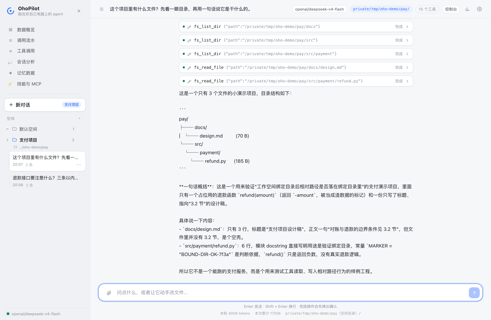
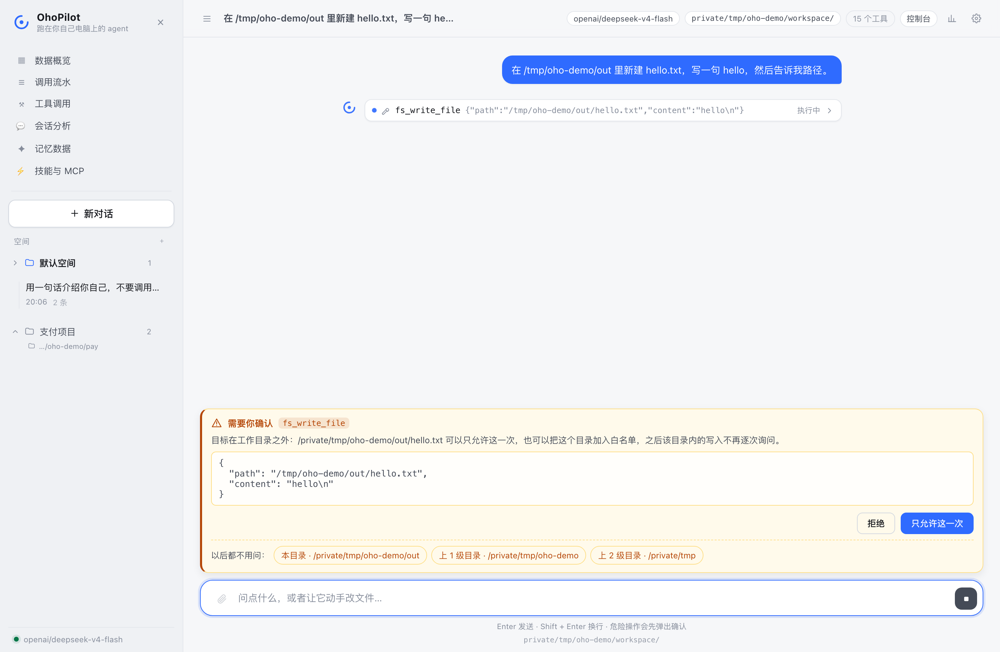
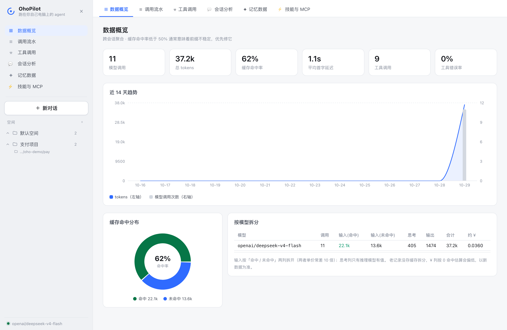
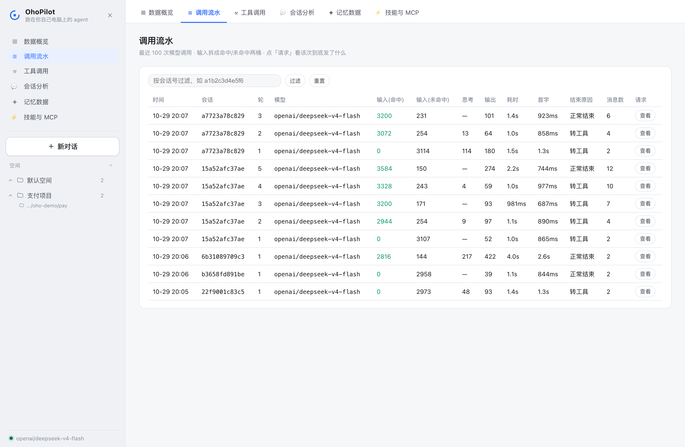
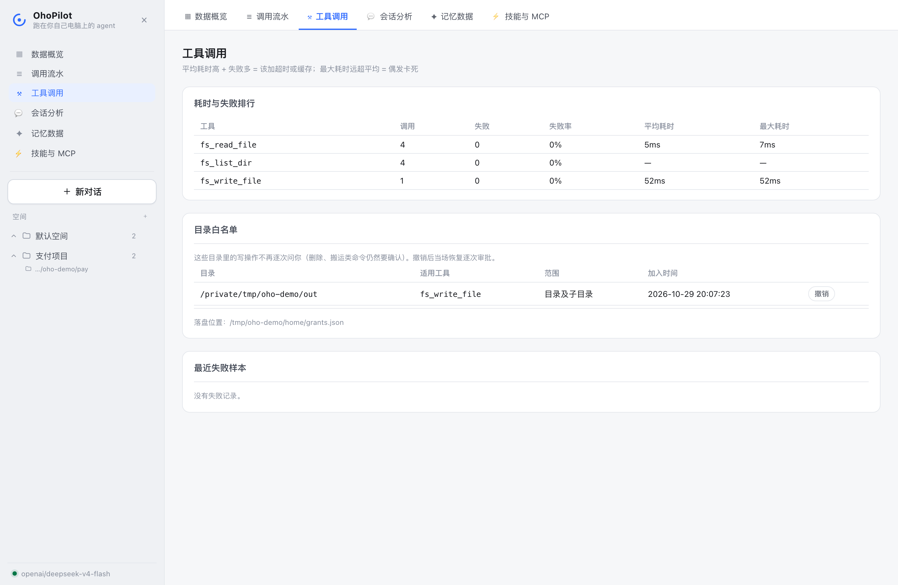
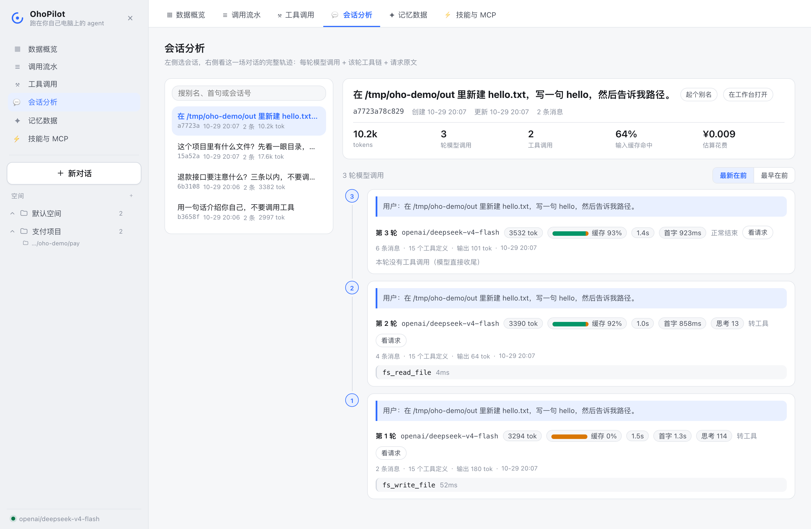
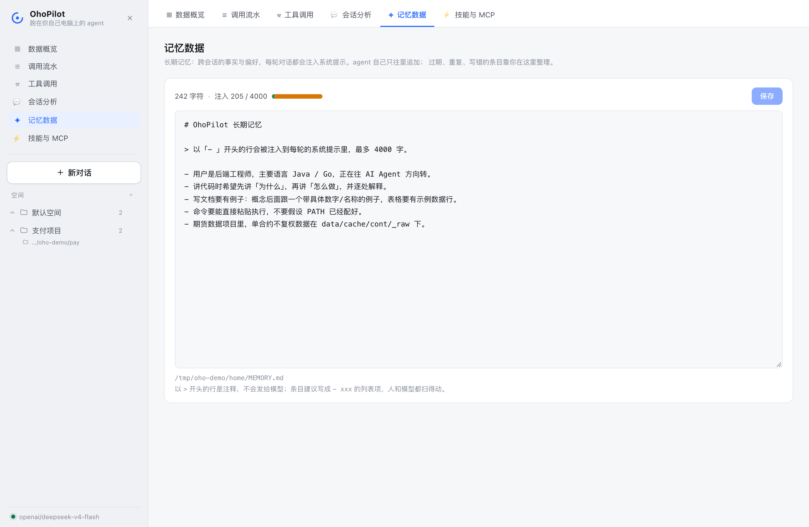

# OhoPilot（哦豁）

跑在你自己电脑上的中文办公 agent。它读写你的文件、执行命令、抓网页，
危险动作先问你一句；对话存在本地 SQLite，重启能接着聊；技能是可编辑的 Markdown 文件。

不是通用聊天壳子：它只做「拿你电脑上的东西办事」这一类活。



> 上图是真跑出来的界面：侧栏上半是控制台的几个入口，下半是「空间 → 会话」；
> 中间那 5 张折叠卡片是这一轮的 5 次工具调用（`fs_list_dir` / `fs_read_file`），
> 点开每一张都能看到完整参数与返回。顶栏右侧那个高亮的路径，是这个会话的工作目录
> ——它来自「支付项目」空间绑定的本地文件夹，不是全局设置（第 39 步）。

## 它有什么

- **15 个内置工具**：读/写/列目录/搜索、读 PDF/Word/Excel、执行 shell、抓网页、**搜网页**、写长期记忆、取技能正文/**装新技能**、任务清单（todo）、知识库索引/语义检索（kb）。
- **三档 shell 判定 + 目录白名单**：只读命令静默执行，改动类弹审批，提权删根类直接拒绝；审批时可以选「只这次 / 这个文件 / 这个目录」，选了目录之后同类操作不再逐次打扰，随时能在控制台撤销。
- **四层安全边界**：默认工作目录 → 硬禁止清单（`.env`/`.git`/凭据目录）→ 目录白名单 → 人工审批。
- **空间 = 会话分组 + 工作目录**：会话按空间归档，每个空间可绑定一个本地文件夹——绑了之后，该空间里的会话以它为工作目录（相对路径相对它解析、读写它不再逐次问），多个项目互不串（见 [空间与工作目录](#空间与工作目录)）。
- **两层记忆**：会话历史（SQLite，滚动摘要压缩）+ 长期记忆（`MEMORY.md`，注入每轮提示词，控制台里可直接编辑）。
- **技能系统**：`~/.ohopilot/skills/*.md`，系统提示里只放目录，按需取正文（渐进披露）。
- **两个客户端 + 一个网页工作台**：终端 CLI、HTTP + SSE 服务端，以及一个对标豆包/WorkBuddy 的网页界面（React + TS + Vite，构建产物由 `oho-server` 直接托管，**不需要装 Node 也能用**）。
- **内核与界面解耦**：三者只通过 9 类事件通信，换界面不动内核。

## 快速开始

**方式一：一键安装（推荐，幂等可重复执行）**

```bash
./install.sh                # venv + 全部依赖组 + 生成 .env + 装配自检
./start.sh                  # 起服务并打开网页工作台
```

**方式二：手动**（想知道每步在干什么时用）

```bash
cd ~/Desktop/AI软件开发/Agent/OhoPilot
source .venv/bin/activate
pip install -e ".[dev,server]"
cp .env.example .env
```

**可选依赖组**：核心功能零额外依赖；用到对应功能再装，缺库时工具会报错并提示安装命令。

| 组 | 装法 | 解锁的功能 |
|---|---|---|
| `server` | 已含在快速开始里 | HTTP 服务 + 网页工作台 |
| `docs` | `pip install "ohopilot[docs]"` | `fs_read_document` 读 PDF / Word / Excel（三个解析库共约 40MB） |
| `rag` | `pip install "ohopilot[rag]"` | 知识库 `kb_index` / `kb_search`（另需配 embedding，见 `.env.example`；sqlite-vec 零服务默认，Milvus 可切） |
| `dev` | `pip install "ohopilot[dev]"` | 跑测试 |

> 小提示：`.env` 里加 `LITELLM_LOCAL_MODEL_COST_MAP=True` 可以跳过 litellm 启动时联网拉模型价格表（国内网络会白等约 3 秒）。

## MCP 外部工具

把现成的 MCP 服务器（社区数千个：GitHub、数据库、浏览器……）接进 OhoPilot。创建 `~/.ohopilot/mcp.json`（与 Claude Desktop 同格式，可直接抄现成配置）：

```json
{
  "mcpServers": {
    "filesystem": {
      "command": "npx",
      "args": ["-y", "@modelcontextprotocol/server-filesystem", "/tmp"]
    }
  }
}
```

重启后外部工具自动注册，名字为 `mcp__<服务器>__<工具>`（防重名）。外部工具是第三方代码，**调用前需要你确认**；某个服务器坏了只警告跳过，不影响本地功能。第一版只支持 stdio 传输。

打开 `.env` 填上 `OHOPILOT_API_KEY`，然后一条命令起网页版：

```bash
./start.sh
```

浏览器会自动打开 `http://127.0.0.1:8737`。**服务在前台阻塞，Ctrl+C 或关掉这个终端窗口就停**，不会留后台进程。

脚本做三件事：检查环境（虚拟环境、`fastapi`、`.env`、端口占用）→ 缺前端产物就构建 → 前台启动。缺什么当场报明确的错。

| 命令 | 作用 |
|---|---|
| `./start.sh` | 网页版（API + 界面同端口） |
| `./start.sh --dev` | 开发模式：后端 + vite 热更新，改 `web/src` 即时生效 |
| `./start.sh --rebuild` | 改了前端但没构建时，强制重新 `npm run build` |
| `./start.sh --port 9000` | 临时换端口，不改 `.env` |
| `./start.sh --no-open` | 不自动开浏览器 |

终端版另有一个入口（`./start.sh` 起的是服务，不起终端界面）：

```bash
oho
```

进入交互模式，直接打字提问。内置命令：`/new` 开新会话，`/exit` 退出。

一次性提问（适合写脚本）：

```bash
oho "把当前目录的 py 文件按行数排序"
```

## 三种使用方式

### 1. 终端交互

每次启动自动接续最近一个会话；`/new` 之后旧会话仍留在库里。

### 2. 终端一次性提问

带参数就答一次然后退出，每次开新会话、不带上下文。

### 3. HTTP + SSE 服务端

```bash
oho-server
```

默认监听 `127.0.0.1:8737`（只绑本机，不要对外暴露——它能执行 shell）。

健康检查：

```bash
curl --noproxy '*' http://127.0.0.1:8737/health
```

> `--noproxy '*'` 是给开了系统代理的机器用的。不加的话 curl 会把本机请求也丢给代理，直接连不上。

问一轮，流式读事件：

```bash
curl --noproxy '*' -N -X POST http://127.0.0.1:8737/chat \
  -H 'Content-Type: application/json' \
  -d '{"message":"你好"}'
```

每行是 `data: {"type": "...", ...}`，事件类型见下表。新会话的 id 在响应头 `X-Session-Id` 里；
接续会话就把它填回 `session_id`。

审批回传（客户端收到 `approval_request` 事件后）：

```bash
curl --noproxy '*' -X POST http://127.0.0.1:8737/approvals/<call_id> \
  -H 'Content-Type: application/json' -d '{"allow":true}'
```

其他端点：`GET /sessions`（会话列表，带标题与条数）、`GET /sessions/{id}`（回放历史）、`POST /settings`（改模型与工作目录）。

## 网页工作台

`oho-server` 起来之后，浏览器打开 `http://127.0.0.1:8737` 就是界面。侧栏是两段式布局（参考 WorkBuddy）：

- **上半：控制台菜单**——数据概览 / 调用流水 / 工具调用 / 会话分析 / 记忆数据 / 技能与 MCP。点谁，右侧 main 区就切到谁，**不刷新、不开新窗口**，聊天状态不丢；
- **横线下面：空间与会话**——「新对话」按钮 + 空间树。会话默认收进空间里，悬停有「⋯」可改名（默认取首句前 60 字）、可挪空间；每个空间可绑定一个本地文件夹。

危险操作时审批卡片浮在输入框上方。设置抽屉里可以在线换模型和默认工作目录，不用重启。



> 上图：让它往工作目录外写文件。卡片上除了「拒绝 / 只允许这一次」，下面一排是**授权范围**——
> 「本目录 / 上 1 级 / 上 2 级」任选其一，选完这个范围内的同类写入不再询问。
> 每一条白名单都记录在控制台 → 工具调用 → 目录白名单，随时撤销（下图）。

界面是 React + TypeScript + Vite 写的，源码在 `web/`。**仓库里已经包含构建产物**（`ohopilot/server/static/`），所以只用 Python 的同学不需要装 Node。

想改界面时才需要前端工具链：

```bash
cd web
npm install
npm run dev
```

- `npm run dev`：起 5173 端口的开发服务器，改动即时热更新；API 请求由 vite 转发到 8737（要先把 `oho-server` 跑起来）
- `npm run build`：类型检查 + 构建，产物直接落到 `ohopilot/server/static/`，之后 `oho-server` 打开的就是新界面

前端有几个值得知道的实现细节（都在源码注释里展开写过）：

1. **不用 `EventSource`**——它只能发 GET、不能带请求体。`web/src/api.ts` 用 `fetch` + `ReadableStream` 手写 SSE 解析。
2. **一条助手消息是有序块列表**（文本/工具/提示/错误），不是一条字符串——工具调用会插在文本流中间，拼成字符串就再也分不清顺序。
3. **审批是反向请求**：SSE 是单向的，前端把 `approval_request` 排成队列弹卡片，点完再 `POST /approvals/{call_id}` 唤醒后端挂起的协程。
4. 会话支持 `?session=<id>` 深链，刷新页面不掉上下文；`?usage=1` 直接打开用量面板。

### 开发者面板：token 花在哪

顶栏的图表图标（或 `?usage=1`）打开用量面板，数据来自 `GET /usage`：

- **总账卡片**：调用次数、总 tokens、**缓存命中率**、平均首字延迟；
- **流水表**：每次模型调用一行——第几轮、prompt / 命中 / 未命中 / 输出各多少、耗时、按前端价格表估算的成本。

为什么命中率是最重要的数字：DeepSeek 对命中前缀缓存的部分按约 1/10 计价。命中率低通常说明每次请求的前缀在变（比如系统提示里混入了时间戳），修它就是省钱。命中率低于 50% 时面板会直接给出这条提示。

实现链路：`llm.py` 挖出各家 API 的缓存字段 → `agent.py` 每轮发 `usage` 事件（带轮次号与上下文构成）→ `runtime.py` 落库到 SQLite 的 `llm_calls` 表 → `/usage` 出数据。主循环自身不碰存储。

### 开发者控制台：跨会话总账

侧栏上半的几个菜单就是控制台——它不是独立站点，而是**同一个 SPA 里 main 区的另一个面板**
（直接开 `http://127.0.0.1:8737/console` 也行，刷新也不会被弹回聊天页）。
主界面看「这一次对话」，控制台看「一直以来的总账」：

**数据概览**——总账卡片（调用次数 / 总 tokens / 缓存命中率 / 首字延迟 / 工具错误率）、
近 14 天趋势（tokens 面积 + 调用数柱状，双轴）、缓存命中分布、按模型拆分
（配了 `OHOPILOT_FAST_MODEL` 时路由省钱的效果直接看这张表：便宜模型的行占比涨上来 = 路由生效）：



**调用流水**——每次模型调用一行（最新在前），可按会话过滤；带「查看」能展开那一轮的
请求构成（系统提示 / 历史 / 工具定义各占多少），排查上下文膨胀就靠它：



**工具调用**——谁最忙、谁失败多、平均/最大耗时，外加**目录白名单面板**：
agent 现在可以免审批写哪里，一目了然，一键撤销：



**会话分析**——左侧挑会话，右侧是它的完整档案：逐轮模型调用（缓存命中率、耗时、思考量）、
逐次工具调用（第几轮、耗时多少），点会话号可跳回工作台接着聊：



**记忆数据**——长期记忆原文直接编辑。`242 字符 / 注入 205 / 4000` 三个数并排：
写进文件的不等于模型看得到的（去注释、按上限截断），两个数对得上才放心：



接口按 `/console/api/*` 前缀分组——单用户阶段不做鉴权，将来拆独立服务时整组迁走即可。

### 空间与工作目录

空间不是文件夹的替身，它做两件事：**给会话分组** + **决定这个会话的文件边界**。

- 空间 ⋯ 菜单里「绑定本地目录」，之后该空间里的会话以那个目录为工作目录：
  相对路径相对它解析、读写它不再逐次审批（`.env` / `.git` 仍然硬拒绝）；
- 没绑目录的空间（含默认空间）用设置抽屉里的**默认工作目录**；
- 绑定的目录被删了？那轮对话**降级**到默认目录继续，并给一条提示，而不是直接报错。

为什么这样设计、并发怎么不串：`cfg.workspace` 是进程级的，而服务端可能同时跑多个会话
（A 空间 `/proj/a`、B 空间 `/proj/b`），直接改它会互相踩。所以工作目录存在 **ContextVar**
里——asyncio 每个任务拷贝一份上下文，任务之间天然隔离；工具在调用时才读，
同一个工具实例就能同时服务不同目录的会话（实现见 `ohopilot/workspace.py`，用例见
`tests/test_workspace.py`，其中有一条就是两个并发会话各用各的目录的回归测试）。

### 桌面端（Tauri 壳）

`src-tauri/` 是 Tauri 2 的脚手架：壳 = 一个指向 `http://127.0.0.1:8737` 的原生窗口，界面 100% 复用网页工作台。打包 .app 需要 Rust 工具链（一次性安装），步骤见 `src-tauri/README.md`。

## 一次问答发生了什么

```
你 ──"整理下项目里的 TODO"──▶ Runtime.ask()
                                 │
                                 ├─ ① 未压缩消息超阈值？→ 压一批成摘要，history 换成「摘要+最近几条」
                                 │
                                 ├─ ② Agent.run()：组系统提示（身份/目录/工具/长期记忆/技能目录/规则）
                                 │        │
                                 │        ├─ ③ stream_chat 流式要模型 → 边收边吐 text 事件
                                 │        │
                                 │        ├─ ④ 模型要调工具 → tool_call 事件
                                 │        │      ├─ 要审批？→ approval_request 事件 → 等人回答
                                 │        │      └─ safe_run（兜异常 + 截断结果）→ tool_result 事件
                                 │        │
                                 │        └─ ⑤ 结果回填进消息，回到 ③（最多 max_tool_rounds 轮）
                                 │
                                 └─ ⑥ 双写：内存 history（进下轮 prompt）+ SQLite（进硬盘）
                                          → done 事件
```

关键点：**内核不知道自己在哪个会话里**，也从不 print。会话 id 由入口给，
显示由入口做——所以终端和 HTTP 能共用同一个 `Runtime.ask()`。

## 事件协议

| type | 什么时候发 | 关键字段 |
|---|---|---|
| `text` | 模型输出增量 | `delta` |
| `tool_call` | 模型决定调工具 | `id` `name` `arguments` |
| `tool_result` | 工具执行完 | `id` `name` `content` `is_error` |
| `approval_request` | 需要人工确认 | `id` `name` `arguments` `reason` |
| `usage` | 一轮模型调用结束 | `prompt_tokens` `completion_tokens` `total_tokens` |
| `todo` | 清单工具刚执行完 | `items`（全量快照，界面据此重画清单） |
| `notice` | 给界面的提示（如已压缩） | `message` |
| `error` | 出错 | `message` |
| `done` | 本轮结束 | `session_id` |

`notice` 单独一类而不是塞进 `text`：`text` 会被当成模型输出存进历史，
提示信息不该落库、也不该影响下一轮 prompt。

## 工具清单

| 工具 | 作用 | 审批 |
|---|---|---|
| `fs_read_file` | 带行号读文本，支持 offset/limit | 否 |
| `fs_write_file` | 整文件覆盖写，父目录自动建 | 是 |
| `fs_list_dir` | 列一层目录，目录带 `/`，文件带字节数 | 否 |
| `fs_search` | 文件名 + 内容搜索，剪掉噪声目录 | 否 |
| `shell_run` | 执行 shell 命令 | 三档 |
| `web_fetch` | 抓网页转纯文本（挡 SSRF） | 否 |
| `web_search` | 关键词搜网页，返回标题+链接+摘要（后端可切） | 否 |
| `memory_append` | 往长期记忆追加一条 | 是 |
| `skill_load` | 取某个技能的正文 | 否 |

`shell_run` 的三档判定：

- **allow**：命令在只读白名单里，**且**不含 shell 元字符（`; & | > < \` $ 换行`）→ 静默执行。
  两个条件缺一不可：`ls; rm -rf ~` 的第一个词也是 `ls`。
- **ask**：其余一切（含管道、重定向、串联、越出工作目录的路径）→ 弹审批。
- **block**：提权、删根目录、磁盘操作、下载即执行、碰 `.env` 与凭据目录 → 直接拒绝，连审批都不给。

第四档（叠加在 ask 上）：**目录白名单**。审批时选了「本目录 / 上 1 级」，之后凡是
"命令里出现的路径全在这个目录内、且没有任何删除/搬运/改权限动作"的 ask 直接执行。
判断只认路径不认命令前缀——前缀能被无数种写法绕过，路径才是用户真正授权的东西。
全文词匹配拦 `rm` 这类词，所以 `find … | xargs rm` 也混不进去。

引号里的内容先被抹掉再判断元字符——否则 `git log --pretty=format:"%ad | %s"` 会被误判成管道。
但 `block` 那一档拿原文匹配：宁可误杀，不可漏放。

## 安全边界

五层，从内到外：

1. **工作目录**：文件工具的路径 `resolve()` 后必须落在当前会话的工作目录内（空间绑了目录就是那个目录，没绑就是默认工作目录），越界读写都拒。
2. **硬禁止清单**：路径里出现 `.env` / `.git` 一律拒绝，读写都拒，**白名单也放行不了**。读 `.env` 会把密钥送进模型对话，和写坏它一样严重。
3. **人工审批**：写文件（含工作目录内——"覆盖已有文件"本身可能就是误操作）、写长期记忆、疑似危险的 shell 命令，都要用户点头。没人能批准时（比如管道里跑）一律按拒绝处理。
4. **目录白名单**：审批时明确授权过的目录才免问，且删除/搬运/改权限类命令永远不免；全部记录在案，控制台可查可撤。
5. **子进程环境剥离**：`shell_run` 起的子进程拿不到任何名字里带 `KEY`/`TOKEN`/`SECRET`/`PASSWORD` 的变量，也拿不到 `OHOPILOT_*` 配置——否则模型执行一次 `env` 就能把 key 读走。

另外：`web_fetch` 在发请求**之前**做 SSRF 校验，先挡本地名，再把域名解析成 IP 判断是否内网/回环/链路本地（云厂商元数据地址 `169.254.169.254` 就在这一档），所以 `127.0.0.1.nip.io` 这种伪装域名也过不去。

## 目录结构

```
ohopilot/
├── config.py            统一读环境变量与 .env，别处不再碰 os.environ
├── workspace.py         这一轮该用哪个工作目录（ContextVar，按会话隔离）
├── core/
│   ├── events.py        内核与界面的词汇表
│   ├── llm.py           LiteLLM 薄封装：stream_chat + complete
│   └── agent.py         主循环（心脏）
├── tools/
│   ├── base.py          工具模具 + 注册表 + 结果截断 + 审批范围钩子
│   ├── fs.py            读/写/列/搜
│   ├── shell.py         三档判定 + 目录白名单 + 进程组超时
│   ├── grants.py        目录白名单的存取（grants.json，原子写）
│   ├── web.py           SSRF 防线 + HTML 提取
│   ├── memory.py        长期记忆写入
│   └── skills.py        技能正文读取
├── memory/
│   ├── store.py         SQLite 会话库（历史 + 摘要 + 空间/别名）
│   ├── longterm.py      MEMORY.md 读写
│   └── summarize.py     滚动摘要
├── skills/loader.py     Markdown 技能解析
├── runtime.py           装配 + 一轮问答编排（含按会话切工作目录）
├── cli.py               终端入口（只做渲染与 y/n）
├── server/
│   ├── app.py           FastAPI：/health /sessions /chat(SSE) /approvals /settings + 前端托管
│   ├── approvals.py     ApprovalBroker：Future 挂起 + HTTP 唤醒
│   └── static/          网页工作台的构建产物（源码在 web/，入库使克隆即用）
└── ../web/              前端源码（React + TS + Vite，与 python 包平级）
    └── src/
        ├── api.ts       fetch + ReadableStream 手写 SSE 客户端
        ├── state.ts     对话状态机（reducer + applyEvent 纯函数）
        ├── types.ts     与 core/events.py 一一对应的「合同」
        └── components/  Sidebar / Topbar / MessageList / ToolCard / Composer / ApprovalBar / Drawer
```

运行时数据在 `~/.ohopilot/`：`ohopilot.db`（会话）、`MEMORY.md`（长期记忆）、`skills/`（技能）。

## 配置

全部走环境变量（或 `.env`），前缀 `OHOPILOT_`。

| 变量 | 默认值 | 说明 |
|---|---|---|
| `OHOPILOT_API_KEY` | 空 | 模型密钥；为空时 CLI 直接退出，服务端 `/chat` 返回 503 |
| `OHOPILOT_MODEL` | `deepseek-v4-flash` | 换模型只改这里 |
| `OHOPILOT_API_BASE` | `https://api.deepseek.com` | 指向本地模型（Ollama/vLLM）时可免 key |
| `OHOPILOT_WORKSPACE` | 当前目录 | **默认**工作目录；空间绑定的目录优先于它 |
| `OHOPILOT_HOME` | `~/.ohopilot` | 数据目录 |
| `OHOPILOT_ALLOW_WRITE` | `1` | 文件写入总开关；设 `0` 变只读模式（`fs_write_file` 一律拒绝） |
| `OHOPILOT_SHELL_TIMEOUT` | `60` | 单条命令上限秒数 |
| `OHOPILOT_MAX_TOOL_ROUNDS` | `12` | 一轮问答里最多几次工具往返 |
| `OHOPILOT_SUMMARY_AFTER` | `24` | 未压缩消息超过这个数就压一批；`0` 关闭摘要 |
| `OHOPILOT_SUMMARY_KEEP` | `8` | 压缩后始终保留原文的最近条数 |
| `OHOPILOT_HOST` / `OHOPILOT_PORT` | `127.0.0.1` / `8737` | 服务端监听地址 |
| `OHOPILOT_APPROVAL_TIMEOUT` | `180` | HTTP 审批等待上限，超时按拒绝 |
| `OHOPILOT_SEARCH_PROVIDER` | `searxng` | 网页搜索后端：`searxng` / `tavily` / `bocha` |
| `OHOPILOT_SEARXNG_BASE_URL` | `http://127.0.0.1:8080` | 自建 SearXNG 地址 |
| `OHOPILOT_TAVILY_API_KEY` | 空 | provider 为 tavily 时必填 |
| `OHOPILOT_BOCHA_API_KEY` | 空 | provider 为 bocha 时必填 |

## 网页搜索：技术选型

`web_search` 的后端可切换（改 `OHOPILOT_SEARCH_PROVIDER`），三家对比：

| 后端 | 费用 | 中文效果 | 访问 | 适合 |
|---|---|---|---|---|
| **searxng**（默认） | 完全免费（自建） | 中等，取决于聚合的引擎 | 本机直连 | 日常默认，零成本无限量 |
| **tavily** | 免费 1000 次/月，之后付费 | 中上 | 国内常需代理 | Agent 生态标配，结果结构化好 |
| **bocha** | ≈0.03 元/次 | 最好 | 国内直连 | 要高质量中文结果时 |

**后端只是配置，没有写死**：三个后端对应同一套工具代码，切换 = 改 `.env` 里一行 `OHOPILOT_SEARCH_PROVIDER`（用 tavily/bocha 时另配对应 key），代码零改动。

**免费与代价要一并看**：searxng 完全免费、无次数限制，但有两个代价——① 稳定性靠自己：上游搜索引擎会反爬，某几家抓不到时要等社区跟进；② 返回的是原始搜索结果（标题+链接+摘要），噪音比商业 API 多一点。tavily 则替你扛了反爬和结果清洗，免费额度 1000 次/月对个人够用。

**推荐用法**：开发调试用 `searxng`（免费随便造），日常正式使用或演示切 `tavily`（质量稳，额度够）。

**SearXNG 自建**（默认后端）两步：

```bash
docker run -d --name searxng -p 8080:8080 searxng/searxng
docker exec searxng sh -c \
  "sed -i 's/formats: - html/formats: - html\n    - json/' /etc/searxng/settings.yml && docker restart searxng"
```

- 第一行：起服务，映射到本机 8080
- 第二行：SearXNG **默认关闭 JSON 输出**（反爬措施），而我们的工具走 `format=json`，必须打开；改完重启生效
- 验证：`curl --noproxy '*' 'http://127.0.0.1:8080/search?q=test&format=json'` 返回 JSON 即成功

安全设计：搜索端点全部来自配置，模型只能控制关键词——「去哪查」它说了不算，所以不像 `web_fetch` 那样需要 SSRF 防护。本机 searxng 请求固定绕过系统代理（`trust_env=False`），公网 API 保留代理。

## 写一个技能

技能是 Markdown，一个文件一个技能，放在 `~/.ohopilot/skills/`：

```markdown
---
name: weekly-report
description: 生成周报。用户提到周报、本周总结、这周做了什么时使用。
---
1. 用 shell_run 跑 `git log --since="7 days ago" --oneline`
2. 按项目分组，每组挑 3 条有信息量的提交
3. 输出：本周完成 / 进行中 / 下周计划，每项不超过两行
```

规则（都写在 `skills/loader.py` 里）：

- `description` 必填。它是模型判断「要不要用这个技能」的唯一依据，缺了整份文件被丢弃。
- 正文不能为空，否则和 `description` 重复。
- 正文上限 8000 字符，超了截断。
- `name` 只允许字母数字下划线连字符，同名只保留第一个。

为什么不做成工具：工具是**代码能力**，每加一个都占 function calling 的 schema 预算；
技能是**提示词能力**，系统提示里只占一行。加十个技能只多十行 token。

## 测试

```bash
.venv/bin/python -m pytest
```

373 个用例，分几类：

| 文件 | 覆盖什么 |
|---|---|
| `test_agent.py` | 主循环：工具往返、审批、错误、轮次上限、系统提示、usage 事件 |
| `test_server.py` | SSE 格式、同会话串行、审批全链路、Broker 超时/取消、设置与 /usage 端点 |
| `test_store.py` `test_summarize.py` `test_longterm.py` | 存储、摘要阈值与累积、记忆注入、用量流水与总账 |
| `test_llm.py` | 缓存字段的各家格式挖取（挖不到时全算未命中，不虚报命中率） |
| `test_shell.py` `test_fs_tools.py` `test_web.py` `test_skills.py` | 工具边界与安全 |
| `test_grants.py` `test_workspace.py` | 目录白名单的判定/撤销/范围候选；工作目录的默认值、切换、并发隔离、降级 |
| `test_extensions.py` | 空间增删改绑目录、别名、控制台下钻、请求体快照 |
| `test_config.py` `test_cli_render.py` `test_tools_misc.py` | 配置优先级与容错、参数截断、两个薄工具 |

前端没有自动化测试（第一版刻意不做），`npm run build` 里的 `tsc --noEmit` 就是它的类型级测试。

两条纪律：**不碰真实的 `~/.ohopilot`**（每个用例用临时目录），**不发真实网络请求**（模型与下载都换成假的）。

## 已知限制

- 会话库只存 user 与最终 assistant 文本。工具往返不落库——回放一半工具轨迹会产生孤儿 `tool` 消息，模型接口会直接报错。网页版翻历史时也就看不到当时的工具卡片。
- 摘要是一次性的滚动摘要（每个会话一行），不做「摘要的摘要」的版本管理。
- 用量面板只记对话主循环的模型调用；压缩摘要那次后台调用（`complete()`）的用量没有单独记。
- 上下文构成按字符数记录，token 是近似值——模型 API 只回报总数，不回报构成。
- CLI 每问一次开一个新的事件循环；服务端是长驻循环（这是第 15 步专门解决过的坑）。
- 没有流式工具输出，工具只在跑完后一次性返回。
- 单进程、单用户。多用户与鉴权留给云服务版本。
- 改前端代码后要 `npm run build` 才会反映到 `oho-server`（开发时用 `npm run dev` 不用）。
